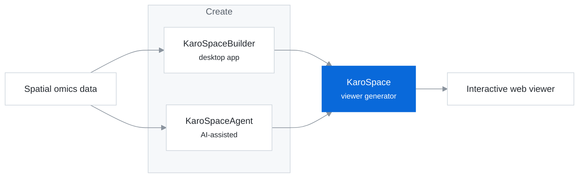

Computational biologist in the Castelo-Branco group at Karolinska Institutet. My research uses spatial and single-cell transcriptomics to study neuroinflammation, and I develop open-source software for analyzing and sharing spatial omics data. Co-founder of [spatialist](https://www.spatial.ist).

<code>──────────── research ────────────</code>

### KaroSpace

Open-source toolkit for turning spatial omics datasets into interactive, shareable web viewers.

| Repository | Description |
|---|---|
| [**KaroSpace**](https://github.com/christoffermattssonlangseth/KaroSpace) | Core library for generating viewers |
| [**KaroSpaceBuilder**](https://github.com/christoffermattssonlangseth/KaroSpaceBuilder) | Graphical application for building viewers without code |
| [**KaroSpaceAgent**](https://github.com/christoffermattssonlangseth/KaroSpaceAgent) | AI agent for configuring viewers from a dataset description |

### Unpublished work

| Project | Status |
|---|---|
| Spatiotemporal modeling of tissue in disease |  |

Code will be released upon publication. Collaboration inquiries are welcome.

<code>──────────── applications ────────────</code>

### Applications

| Application | Description | Platform |
|---|---|---|
| [**Lunta**](https://github.com/christoffermattssonlangseth/lunta) | Reference manager with reading views, annotations, full-text search, citation export and a daily literature feed | macOS, iOS |
| [**Grepp**](https://github.com/christoffermattssonlangseth/grepp) | Strength-training log stored as plain Markdown, with an integrated Claude-based coach | iOS |
| [**BarVelo**](https://github.com/christoffermattssonlangseth/BarVelo) | Bar velocity measurement for velocity-based training, integrated with Grepp | iOS · in development |
| [**KidDos(e)**](https://github.com/christoffermattssonlangseth/KidDose) | Dose tracking for pediatric ibuprofen and paracetamol | iOS |
